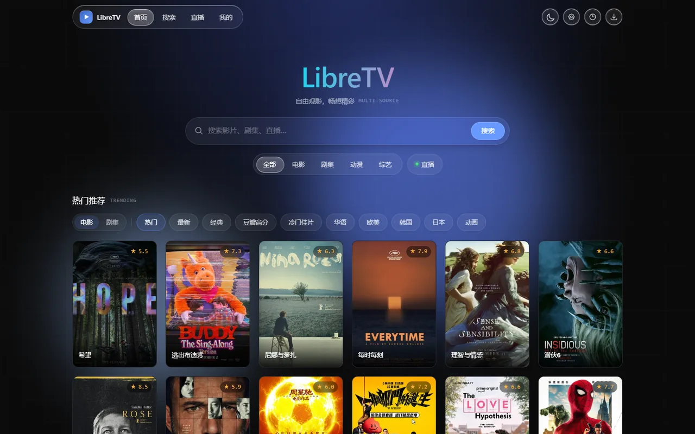
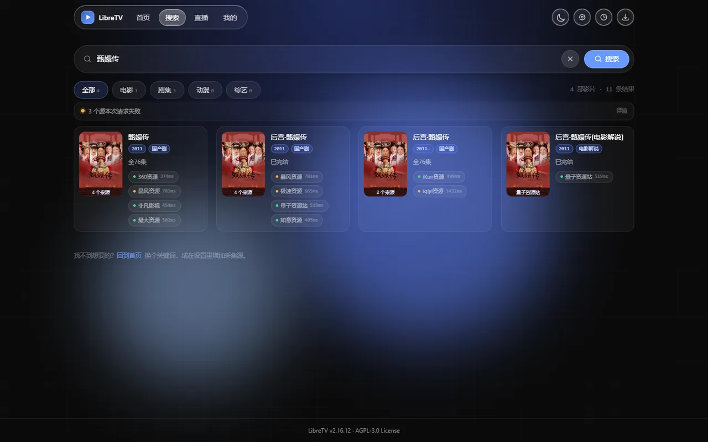
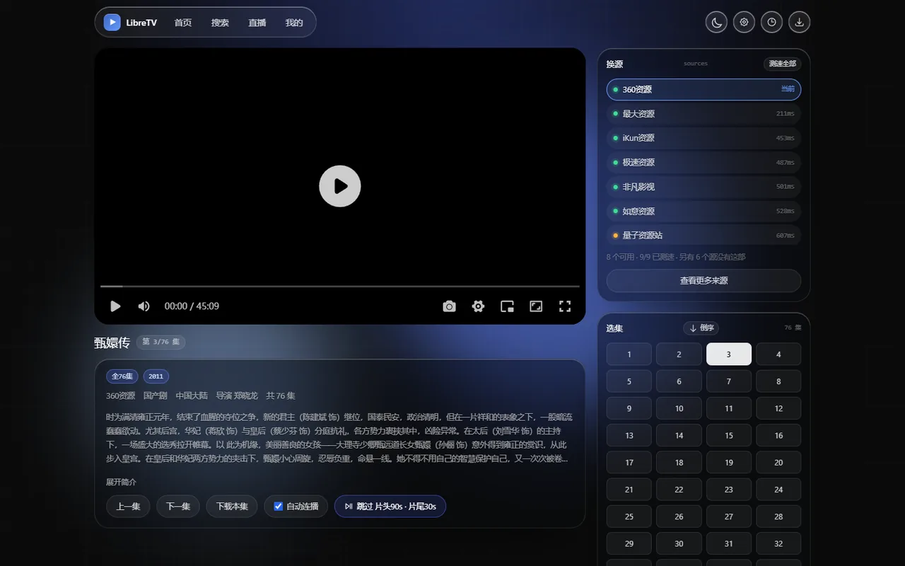
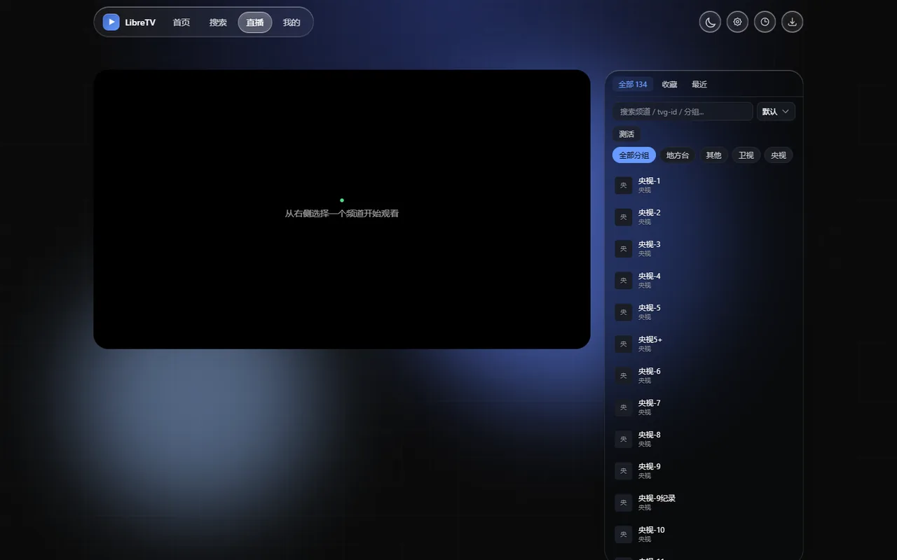
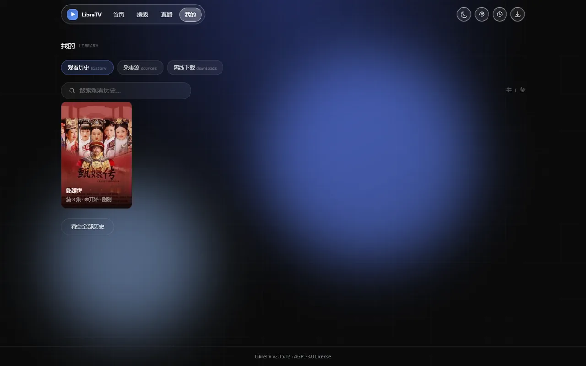

# LibreTV

> 自托管的视频聚合搜索与播放程序。基于 **Next.js 16（App Router，Turbopack）+ TypeScript + Tailwind CSS**，播放内核为 **ArtPlayer + hls.js**，自带亮暗双主题、PWA 安装与 IPTV 直播。**只提供程序，不提供任何播放源。**

本仓库是 **better-libretv**（二改版），上游功能与后端逻辑照旧，重做的是**表现层与客户端交互**：一套新的视觉系统、首页 / 搜索 / 播放 / 直播 / 我的五个页面全部重排版式、换源选源与「跳过片头片尾」等交互补全。技术上相对上游改了什么，见文末[相对上游的主要改动](#相对上游的主要改动)。

**本项目只提供程序本身**：不内置、不分发、不推荐任何点播源、直播源或订阅地址，也不存储任何视频内容。源由使用者自行配置，详见[项目定位](#项目定位)与[隐私说明](#隐私说明)。

<table>
  <tr>
    <td width="50%"></td>
    <td width="50%"></td>
  </tr>
  <tr>
    <td></td>
    <td></td>
  </tr>
  <tr>
    <td></td>
    <td></td>
  </tr>
</table>

> 🏠 **上游官网**：[libretv.is-an.org](https://libretv.is-an.org/)
>
> 📖 **完整文档**：[文档首页](https://libretv.is-an.org/wiki/) · [架构](https://libretv.is-an.org/wiki/Architecture.html) · [部署](https://libretv.is-an.org/wiki/Deployment.html) · [配置](https://libretv.is-an.org/wiki/Configuration.html) · [数据源](https://libretv.is-an.org/wiki/Data-Sources.html) · [直播 / IPTV](https://libretv.is-an.org/wiki/Live-IPTV.html) · [播放器](https://libretv.is-an.org/wiki/Player.html) · [代理与安全](https://libretv.is-an.org/wiki/Proxy-Security.html) · [FAQ](https://libretv.is-an.org/wiki/FAQ.html)

## 核心特性

**搜索与选源**

- **聚合搜索**：多个 Apple CMS 采集站服务端并行搜索，客户端经 NDJSON 流式逐源回吐，慢源不拖整体。
- **跨源同名聚合**：同名影片合并为一张卡片，卡片底部直接列出各来源（带延迟圆点），点哪个就用哪个源的资源开播，不再碰运气。
- **详情弹窗选源**：弹窗顶部列出这部片子的全部来源，切换来源后自动重取详情与剧集列表。
- **相关性过滤**：采集站在查不到时会返回默认全量目录（整站体育、杂项都算「结果」）。服务端按标题做相关性判定后再回吐：多词查询逐词命中、季数别名（第二季 / 第2季 / 2）互相等价、数字带边界（查「2」不会命中 12 与 20），空标题直接丢弃；流式中间结果也过同一套过滤，不会先闪一屏无关内容再消失。
- **源健康度**：搜索时自动记录每个源的成功/超时，连续失败 3 次按阶梯自动停用（30 分钟 → 24 小时 → 长期），失败源压成一行可展开的状态条，不再用三条横幅把结果顶下去。
- **画质标注**：需要时一键「测画质」，逐个源探测真实分辨率，显示为 4K / 1080P / 720P 这类徽章。探测在服务端做，走清单 → 分片 → SPS/moov 解析，单码率源也能算出真实分辨率（不依赖 `#EXT-X-STREAM-INF` 的 RESOLUTION 字段）。判定以**宽度**为准：采集站常把 1920×1080 母带上下裁成 1920×752，只按高度会误标成 720P。

**播放**

- **播放页换源卡**：右栏每行一个源，显示延迟（<600ms 绿 / <1500ms 黄 / 超时红），点一行即换源并保留当前集数；「测速全部」按需触发，播放失败时自动重测。
- **画质菜单**：播放器右上角显示当前实际分辨率。多码率清单（master playlist）会列出全部档位供手动切换（「自动」档按带宽自适应）；单码率源只显示只读胶囊，不摆一个点不动的菜单。
- **跳过片头 / 片尾**：默认关闭（0 秒，不跳），需要时可在播放页按「本剧」覆盖，也可在设置里改全局默认；跳完片头会给出 12 秒「撤销」入口。
- **全屏兜底**：Apple 触屏（iPhone / iPad / iPadOS 桌面 UA）走系统播放器全屏，其余走元素全屏，桌面、Pad、手机各自都能进能出。
- **控制条换集**：播放键右侧是上一集 / 下一集，到头时按钮压暗并提示「没有更多了」（位置固定，不用重新找）；键盘 `Alt + ←/→` 同效。窄屏按档收按钮：≤560px 收起截图、画中画、网页全屏与音量滑杆，≤380px 再收起「视频信息」面板，图标从 40px 压到 26/24px —— 只压 padding 压不动图标，390pt 上左右两区合计会超出可用宽度 32px。
- **快捷键**：空格播放/暂停、←/→ 快退快进 5s、↑/↓ 音量、`F` 全屏、`Alt + ←/→` 切集；移动端长按 3 倍速。
- **离线下载**：播放页可「下载本集」（TS / MP4），任务在「我的 → 离线下载」里看进度。
- **下载健壮性**：分片 4xx 视为确定性缺失，立即失败并提示换源（不再重试 3 次后才发现是死链）；5xx 仍走退避重试。进度落库做了节流，长时间下载不会把 IndexedDB 写爆。设置 → 偏好设置里可切换「经服务器中转下载」，绕开源站对浏览器直连的 Referer / CORS 限制。

**内容与直播**

- **首页推荐**：豆瓣电影/剧集分类浏览、Bangumi 新番放送表、影视榜单（豆瓣周榜 + 百度热播，经 60s API），设置中随时切换，均服务端直连 + 缓存，免 key。
- **直播 / IPTV**：M3U 订阅解析，按分组浏览、搜索频道、批量测活、站内播放（HLS + HTTP-FLV），支持 XMLTV 节目单（EPG）与频道收藏，可导出标准 M3U 给 PotPlayer / VLC。
- **进度同步**：播放进度与观看历史存于本机 IndexedDB，精确到秒续播；首页有「继续观看」入口。

**工程**

- **数据源订阅 / 分享**：一份 LibreTV-SourceList JSON 可同时下发点播源与直播源，也接受 TVBOX 配置地址（自动导入其中可直接使用的接口），可导出、可一键发布为公开链接。
- **PWA**：可安装到桌面 / 主屏幕，亮暗双主题无首屏闪烁，路由切换有顶部进度条。
- **界面语言**：内置中文 / English 切换（设置 → 常规 → 界面语言），覆盖导航、页脚、搜索、播放、直播、我的、设置与错误页面。剧名、采集源名、豆瓣标签与频道名属于**数据**，保持原样不翻译；豆瓣标签是接口查询参数，翻译会让请求落空。
- **自托管**：单容器无状态运行，除访问密码外不需要任何外部依赖（无数据库、无 Redis）。
- **构建链**：Next.js 16 + Turbopack，开发与生产构建共用同一套配置；lint 用 ESLint 9 扁平配置直连 `eslint-config-next`（Next 16 起 `next lint` 已移除）。

## 快速开始

```bash
git clone https://github.com/ZHIFANSONG/better-libretv.git
cd better-libretv

# 必填：设置访问密码
echo "PASSWORD=your-password" > .env

# 拉取发布镜像并启动（监听 8080）
docker compose pull && docker compose up -d
```

打开 `http://localhost:8080`，输入密码即可使用。生产环境请套 HTTPS，原因见下方[部署](#部署)。

## 部署

### Docker（推荐）

```bash
# 方式一：拉取发布镜像（零构建）
docker compose pull && docker compose up -d

# 方式二：本地源码构建
docker compose up -d --build
```

### Docker Compose

```yaml
services:
  libretv:
    image: ghcr.io/zhifansong/better-libretv:latest
    container_name: libretv
    restart: unless-stopped
    ports:
      - "8080:8080"
    environment:
      - PASSWORD=change-me   # 必填：访问密码，务必修改
      # - PROXY_SECRET=your-secret          # 会话/代理签名密钥，多实例部署建议设置
      # - DEFAULT_SOURCES=[{"name":"示例源","url":"https://example.com/api.php/provide/vod"}]
      # - DEFAULT_LIVE_SOURCES=[{"name":"示例直播源","url":"https://example.com/list.m3u"}]
      # - DEFAULT_SUBSCRIPTIONS=["https://example.com/sources.json"]  # 预置订阅，自动导入点播源+直播源
      # - DEFAULT_RECOMMEND_SOURCE=douban    # 首页推荐数据源默认值（douban/bangumi/hot-list）
      # - DEFAULT_IMAGE_MODE=direct          # 封面图加载方式默认值（direct/proxy）
      # - LIVE_ALLOW_PRIVATE=1               # 自建内网 IPTV 源时开启
```

> 其余可选变量见下方[环境变量](#环境变量)表；仓库内的 `docker-compose.yml` 含完整注释版本（含 `build: .` 源码构建分支）。

> ⚠️ **生产部署必须通过 HTTPS 访问**（localhost 除外）：生产模式下会话 cookie 带 `Secure` 标记，浏览器只在 HTTPS（或 localhost）下保存它。因此用 `http://服务器IP:端口` 访问时，会出现「密码正确却无法登录」的现象——登录请求实际成功，但 cookie 被浏览器丢弃。请通过反向代理（Nginx / Caddy / Traefik）或 Cloudflare 等为站点套上 TLS 后再对外提供服务；本地开发用 `localhost` 不受影响。

镜像发布在 GHCR 与 Docker Hub：`ghcr.io/zhifansong/better-libretv` 与 `docker.io/zhifansong/better-libretv`（`latest` / `主.次` / 完整版本号三个 tag，`linux/amd64` 与 `linux/arm64` 双架构，两个 registry 的镜像 digest 一致）。需要固定版本时在 `.env` 中设置 `LIBRETV_IMAGE=ghcr.io/zhifansong/better-libretv:2.18.0`。

> 版本号以 `package.json` 为单一来源，构建时注入 `APP_VERSION`，部署后可用 `/api/status` 返回的 `version` 字段核对。详见[部署文档](https://libretv.is-an.org/wiki/Deployment.html)。

### 手动运行

```bash
npm install
PASSWORD=your-password npm run build
PASSWORD=your-password npm start   # 监听 8080
```

### 环境变量

| 变量 | 必填 | 说明 |
| --- | --- | --- |
| `PASSWORD` | 是 | 访问密码；未设置时站点会提示管理员配置 |
| `PROXY_SECRET` | 否 | 会话/代理签名密钥；不设置时从 `PASSWORD` 派生（多实例部署建议显式设置：`openssl rand -hex 32`） |
| `COOKIE_SECURE` | 否 | 显式覆盖会话 cookie 的 `Secure` 标记（`true` / `false`）；默认按请求协议自动推导。反向代理未正确传递 `x-forwarded-proto` 导致 HTTPS 下登录失效时，设为 `true` 可解 |
| `DEFAULT_SOURCES` | 否 | 预置点播源（JSON 数组），用户端自动出现且默认勾选，详见[配置文档](https://libretv.is-an.org/wiki/Configuration.html) |
| `DEFAULT_LIVE_SOURCES` | 否 | 预置直播源（M3U 订阅，JSON 数组）：`[{"name":"源名","url":"https://.../list.m3u","epg":"https://.../epg.xml.gz"}]`，`epg` 为可选节目单地址 |
| `DEFAULT_SUBSCRIPTIONS` | 否 | 预置数据源订阅（LibreTV-SourceList JSON 链接，也接受 TVBOX 配置地址），JSON 数组。首次访问自动导入，之后每 24h 静默刷新；用户删除后不再自动加回 |
| `DEFAULT_RECOMMEND_SOURCE` | 否 | 首页推荐数据源默认值（`douban` / `bangumi` / `hot-list`，出厂 `douban`）；仅对未在设置中主动选择过的用户生效 |
| `DEFAULT_IMAGE_MODE` | 否 | 封面图加载方式默认值：`direct`（原站直连优先，省服务器流量，出厂值）/ `proxy`（内置代理优先，最稳定）；取值非法时告警并忽略 |
| `LIVE_ALLOW_PRIVATE` | 否 | 设为 `1` 时允许直播流代理访问内网/保留地址（自建 IPTV 场景），默认关闭以维持 SSRF 防护 |
| `REQUEST_TIMEOUT` | 否 | 代理上游请求超时（毫秒），默认 `8000` |
| `MAX_RETRIES` | 否 | 代理请求重试次数，默认 `1` |
| `SEARCH_MAX_PAGES` | 否 | 每个搜索源最多抓取的页数（`1`-`50`，默认 `5`）。第一页会读取源站 `pagecount`，实际页数 = min(源站总页数, 该值)；页间并行请求，单页失败只丢该页 |
| `SEARCH_SOURCE_TIMEOUT_MS` | 否 | 单个搜索源的总死线（毫秒，`3000`-`60000`，默认 `15000`）：该源所有分页请求须在时限内完成，到点中断并标记「超时」，源健康度自动停用也以此为判定依据 |
| `USER_AGENT` | 否 | 代理请求使用的 UA（豆瓣封面防盗链等场景），默认 Chrome UA |
| `FALLBACK_CORS_PROXY` | 否 | 豆瓣推荐数据直连被拒时降级使用的 CORS 代理地址 |
| `60S_API_BASE` | 否 | 影视榜单推荐源（60s API）实例地址，默认 `https://60s.crystelf.top`，请求失败自动回退官方公共实例 `https://60s.viki.moe`；公共实例有限流，高频使用可[自部署](https://github.com/vikiboss/60s) |

> `APP_VERSION` 由构建期从 `package.json` 读取，不需要手动设置。

## 项目定位

- **只做程序，不带源**：仓库里没有任何采集站、直播源、订阅列表或片源地址，代码中出现的 `https://example.com/api.php/provide/vod` 一律是格式示例（占位域名），不指向可用的源。
- **源由使用者自备**：站点首次打开时是空的，需要自己添加 Apple CMS 采集接口（设置 → 源管理 → 点播源）或直播 M3U 订阅后才会有内容；部署者也可以用 `DEFAULT_SOURCES` / `DEFAULT_LIVE_SOURCES` / `DEFAULT_SUBSCRIPTIONS` 为所有人预置。
- **不提供内容、不托管内容**：本项目不附带、不运营、不担保任何第三方内容，程序只负责把使用者填写的地址请求回来并解析播放。内容是否合法、是否可访问，由对应的第三方站点负责。
- **不做内容审核**：作者无法得知、也不干涉使用者配置了什么源。请自行确认所用数据源在其所在地的合法性，并遵守对方站点的使用条款。
- **无遥测、无埋点**：程序不收集任何使用数据，也没有统计 SDK。

## 隐私说明

程序在**你的设备上**保存的数据：

| 存储 | 内容 | 用途 |
| --- | --- | --- |
| 浏览器 localStorage | 界面偏好（主题、首页推荐来源、封面图加载方式、默认跳过秒数等）、你填写的点播源 / 直播源 / 订阅地址、搜索关键词历史、（可选）代理模板 | 下次打开时恢复你自己的设置 |
| 浏览器 IndexedDB | 观看历史与播放进度（精确到秒）、本剧的跳过片头片尾覆盖值、直播测活结果缓存 | 续播与加速 |
| 服务端 Cookie | 一个 httpOnly、HMAC 签名的会话票据（不含密码、不含个人信息） | 记住「已通过密码验证」 |

- 上述数据全部留存于本机浏览器，**不会上传到任何服务器**；清除浏览器数据即全部删除。设置页可导出 / 导入这份配置，导出文件同样只在本地流转。
- 服务端除了 `PASSWORD`，不需要也不要求任何外部账号；不写访问日志到第三方，不接入分析平台。
- 服务端会代浏览器访问**你自己配置的**采集站与订阅地址，因此这些站点的运营方能看到本站服务器的出口 IP；这是聚合播放的固有行为，与第三方站点自身的隐私政策有关，本项目无法控制。
- 「发布为链接」会把**你当前勾选启用的源列表**上传到第三方公开粘贴板（先试 paste.rs，失败降级 0x0.st），生成一条**公开可读**的链接；不想公开就不要用这个按钮，改用「导出数据源」自行保管。
- 封面图默认优先由浏览器直连原站加载（可在设置里改为全部走本站代理）；首页推荐与影视榜单分别请求豆瓣、Bangumi、60s 等公开接口，属于对第三方服务的正常请求。

## 使用说明

1. **添加点播源**：设置 → 源管理 → 点播源 → 添加 API，填入 Apple CMS 采集站地址（如 `https://example.com/api.php/provide/vod`），可选填详情页地址（部分源需要爬详情页提取播放地址）。
2. **搜索**：勾选点播源后输入片名；搜索经服务端聚合、客户端流式回吐，个别源失败不影响整体结果。
3. **选源播放**：结果卡片底部是来源胶囊（源名 + 延迟），点一下直接进播放页；也可以点卡片看详情，在弹窗顶部比较各来源的剧集数量再决定。
4. **换源**：播放页右栏「换源」卡按延迟排序，点一行即换（集数保留）；「查看更多来源」会打开完整面板，展示每个源的剧集数与测速结果。
5. **跳过片头片尾**：默认关闭（不跳）；需要时点播放页动作行最右侧的「跳过片头/片尾」按钮，改的是**本剧**；全局默认值在设置 → 偏好设置 → 播放与过滤。第 1 集不跳片头（首集常是预告或花絮）。
6. **看画质 / 换画质**：搜索结果卡片上点「测画质」可探测各源真实分辨率（一次搜索几十部片不会自动全探，避免压垮源站）；播放页右上角的画质胶囊在多码率源上可点开选档，单码率源只显示当前分辨率。
7. **进度与历史**：自动保存在本设备 IndexedDB，仅定位信息入库，播放时自动同步最新剧集。
8. **配置迁移**：设置 → 数据 → 配置导入导出（兼容旧版 LibreTV-Settings JSON 的历史记录迁移）。

## 播放器

| 操作 | 快捷键 |
| --- | --- |
| 播放 / 暂停 | `空格` |
| 快退 / 快进 5s | `←` / `→` |
| 音量 ±0.1 | `↑` / `↓` |
| 全屏 | `F` / `f` |
| 上一集 / 下一集 | `Alt + ←` / `Alt + →` |
| 三倍速（移动端） | 长按画面 |

- 输入框或按钮获得焦点时不劫持按键，搜索框里按空格不会触发暂停。
- 全屏在 Apple 触屏上交给系统播放器（`video.webkitEnterFullscreen()`）：实现方式是覆盖 Artplayer 实例的 `fullscreen` 存取器，全屏按钮、设置菜单、快捷键 `f` 自动跟着改道。这也是**移除 `crossOrigin: 'anonymous'`** 的原因——带该属性的视频在 iOS 上会被判为跨域媒体，`webkitEnterFullscreen()` 静默失效（表现为「点全屏没反应」），而采集站本来也不给 CORS 头。
- 播放失败时遮罩上直接给「换个源」和「重新加载」两个按钮，不用回侧栏找入口。

## 直播 / IPTV

1. **添加直播源**：设置 → 源管理 → 直播源 → 填入 M3U/M3U8 地址（可选填 XMLTV 节目单地址），添加后自动探活并显示频道数量；也可在「源管理 → 数据源订阅」中与点播源一起订阅导入；部署者还可用 `DEFAULT_LIVE_SOURCES` 环境变量预置。
2. **观看**：进入「直播」页，按分组标签筛选或搜索频道，点击即播；支持 HLS（m3u8）与 HTTP-FLV 两种直播流，直连失败自动走代理通道重试。
3. **节目单**：频道带 `tvg-id` 且订阅配置了 EPG 地址时，展示当前/接下来节目与播放进度。
4. **收藏与导出**：频道可收藏；订阅可一键导出为标准 M3U 文件，供 PotPlayer / VLC 等外部播放器使用。

完整说明见 [直播 / IPTV 文档](https://libretv.is-an.org/wiki/Live-IPTV.html)。

> ⚠️ 项目不内置任何频道源，也不存储、不制作任何直播内容，仅提供第三方公开播放列表的解析与播放能力，内容的合法性由对应数据源负责。内网自建源默认被 SSRF 防护拦截，自部署者可显式设置 `LIVE_ALLOW_PRIVATE=1` 放行。

## 数据源订阅 / 分享

数据源（点播源 + 直播源）可以 **导出为一份 JSON → 托管到公开 URL → 他人在「设置 → 源管理 → 数据源订阅」里填入该 URL 订阅**。

托管地址没有特殊要求，可用 [npoint.io](https://www.npoint.io/) 免费托管 JSON（粘贴内容即可得到一个公开 URL），Gist、对象存储、任意静态托管同样可用。

### 订阅格式（LibreTV-SourceList JSON）

```json
{
  "name": "我的源列表",
  "version": 2,
  "sources": [
    {
      "name": "示例点播源",
      "url": "https://example.com/api.php/provide/vod",
      "detail": "https://example.com",
      "isAdult": false
    }
  ],
  "liveSources": [
    {
      "name": "示例直播源",
      "url": "https://example.com/list.m3u",
      "epg": "https://example.com/epg.xml.gz"
    }
  ]
}
```

**字段说明**：

| 字段 | 位置 | 类型 | 必填 | 说明 |
| --- | --- | --- | --- | --- |
| `name` | 顶层 | string | 否 | 列表名称，订阅后显示在订阅条目上；缺省时显示订阅地址主机名 |
| `version` | 顶层 | number | 否 | 格式版本，当前为 `2`（新增 `liveSources`）；导入端目前忽略该字段 |
| `sources` | 顶层 | array | 否 | **点播源**数组（Apple CMS 采集站），最多 100 个，超出部分截断 |
| `sources[].name` | 项 | string | 否 | 源显示名；缺省时使用 URL 主机名 |
| `sources[].url` | 项 | string | **是** | Apple CMS 采集接口地址（公网 http/https），结尾 `/` 自动去除 |
| `sources[].detail` | 项 | string | 否 | 详情页根地址，用于列表接口拿不到播放地址、需要爬详情页提取 m3u8 的源 |
| `sources[].isAdult` | 项 | boolean | 否 | 成人内容标记，默认 `false`。标记为 `true` 的源名称旁显示 **(18+)** 徽章；设置中的「成人内容过滤」开启（默认开启）时该源不可勾选、不参与搜索 |
| `liveSources` | 顶层 | array | 否 | **直播源**数组（M3U 播放列表），最多 50 个，超出部分截断 |
| `liveSources[].name` | 项 | string | 否 | 源显示名；缺省时使用 URL 主机名 |
| `liveSources[].url` | 项 | string | **是** | M3U 播放列表地址（http/https） |
| `liveSources[].epg` | 项 | string | 否 | XMLTV 节目单地址（`xml` / `xml.gz`），用于 `/live` 页展示节目单；地址非法时只丢弃该字段、保留整条源 |

**兼容与限制**：

- 只写 `sources` 的老订阅照常可用（纯点播），只写 `liveSources` 则是纯直播订阅；两者都缺时提示「订阅内容格式不正确」；裸数组 `[{ "name": "...", "url": "..." }]` 视为点播源；
- 按 `url` 去重（先到先得）；非 http(s) 地址会被过滤；**点播源**另需为公网地址（内网/回环/保留地址会被静默过滤），**直播源**在部署者设置 `LIVE_ALLOW_PRIVATE=1` 时可使用内网自建源地址；
- 订阅由**服务端**拉取（拉取前经过 SSRF 校验），因此订阅地址**无需配置 CORS**，Gist、对象存储、任意静态托管均可。

### 兼容 TVBOX 配置

订阅地址也可以直接填 **TVBOX 配置**（形如 `{"sites": [...], "lives": [...], "parses": [...]}`）：服务端按内容结构自动识别格式，无需手动选择。

- **点播源**：导入 `sites` 中 `type: 1` 的 JSON 接口（即 Apple CMS 采集站）；部分共享配置省略 `type` 或写成 `0`，但地址命中 `api.php/provide/vod` 时同样导入；站点自身标记 `searchable: 0`（不可搜索）时跳过；
- **直播源**：导入 `lives` 中 `type: 0`（或省略）的 M3U 播放列表，`epg` 字段一并带上；txt 频道列表与单仓 JSON 不支持；
- **Spider 类站点会跳过**：`type: 3` 的 Spider（`csp_*` / `.jar` / `.js` / `.py`）需要 TVBOX 自身的 Spider 引擎才能运行，Node 侧无法执行；XML 接口、外链 JSON 同理。被跳过的条目不影响其余导入，导入结果会如实提示，如「已同步 8 个点播源、2 个直播源（TVBOX 配置）；跳过 96 个不可用条目（Spider 引擎 92、XML 接口 4）」；
- TVBOX 配置常含上百条站点且以 Spider 为主，**只导入个位数到十几个属正常现象**；
- **格式容错**：配置里的 `//` 注释、尾随逗号、字符串内未转义的换行会自动修正后再解析（共享配置中很常见，TVBOX 客户端用的 fastjson 同样容忍这些写法）；
- 其他限制：订阅地址需直接返回 JSON（Base64 / 压缩包装的分享链接不支持）；TVBOX「多仓」配置（顶层为 `urls` 数组）不支持，请填单仓配置；地址公网校验、去重与数量上限与上方格式完全一致。

### 订阅行为

- **订阅**：设置 → 源管理 → 数据源订阅 → 填入订阅地址 → 「订阅」，导入的点播源自动勾选、直播源自动启用，均带「订阅」标识，条目上显示「点播 N · 直播 M」；
- **同步**：订阅条目上的 **⟳** 手动强制同步，整体替换该订阅名下的点播源与直播源；
- **管理边界**：订阅源以远端列表为准，单独编辑会在下次同步时被覆盖，单独移除会在重新同步时恢复；如需调整请改远端列表，或直接删除整个订阅。删除订阅时点播源全部移除；直播源为**多归属共享**——同一 M3U 可被多个订阅引用（名称/EPG 以首次导入为准），删除订阅或远端列表中移除该源后再同步，都只摘除本订阅的引用，仅当不再被任何订阅引用时才移除该源，手动添加的源不受同步影响，**收藏的频道始终保留**；
- **导出分享**：设置 → 源管理 → 数据源订阅 → 「导出数据源」，把当前全部点播源与直播源（预置 + 手动 + 订阅，按 URL 去重）导出为上述 JSON；也可用「发布为链接」，把当前**已勾选启用**的源一键上传到公开粘贴板（paste.rs，失败自动降级 0x0.st），直接返回可填入订阅框的 URL。注意：发布的内容**公开可读**，且每次发布生成新链接、不支持覆盖更新，需长期稳定请用导出 + 自行托管。

> 订阅由服务端拉取（经过 SSRF 校验），因此订阅地址无需配置 CORS。完整说明见 [数据源文档](https://libretv.is-an.org/wiki/Data-Sources.html)。

## 开发

```bash
npm install
PASSWORD=dev-password npm run dev   # http://localhost:8080
npm test                            # vitest：26 个测试文件 / 312 个用例（cms-parser / m3u8 / ssrf / 订阅同步 …）
npm run typecheck                   # tsc --noEmit
npm run lint                        # eslint src
```

目录速览：`src/app`（App Router 页面与 17 个 API 路由）、`src/components`（播放器、换源、设置、详情弹窗等）、`src/lib`（采集站解析、m3u8、SSRF、订阅、IndexedDB、zustand store）、`src/app/proposal.css`（本二改版的整套皮肤）、`src/app/globals.css`（token 与基础层）。

测试范围、发布流程与文档结构见 [开发文档](https://libretv.is-an.org/wiki/Development.html)。

## 发布新版本

版本号以 `package.json` 为单一来源，发布镜像由 GitHub Actions 自动完成：

```bash
npm version patch       # 或 minor / major；会更新 package.json 并打 git tag
git push && git push --tags
```

CI 校验 tag 与 `package.json` 版本一致后，自动构建并推送 `ghcr.io/zhifansong/better-libretv:<版本>`（amd64 + arm64 分架构构建）。详见[部署文档](https://libretv.is-an.org/wiki/Deployment.html)。

## 相对上游的主要改动

上游的接口协议、鉴权、代理与采集站解析逻辑保持原样；本二改版集中在**表现层、播放器行为与客户端交互**。以下按方向归纳，便于对照上游 diff。

**1. 样式与主题层独立**

- 新皮肤集中在一个约 2000 行的 `src/app/proposal.css` 中，`globals.css` 只保留设计 token 与基础层；版式切换靠类名钩子（`.g-shell` / `.g-stage` / `.g-panel` / `.g-seg` …），组件结构基本不动 —— 上游后续的功能合并不容易和新样式打架。
- 玻璃质感使用 glassium 的 **CSS 后端**（`backdrop-filter: blur() saturate()` + `--glassium-refract` 位移贴图），不启用 WebGL 后端：后者在容器化环境里会把海报整块盖空，且每帧一张全屏画布在移动端耗电明显。
- 页面背景（网格 + 两团漂移光斑）是两层 `fixed` 的 `.g-mesh` / `.g-bg`，压在内容层之下 —— 模糊需要有东西可模糊，玻璃层不能悬在纯色底上。
- 导航选中态气泡靠脚本量取激活项盒子后平移（`src/lib/glass-nav.ts`）：glassium 的 `glass-glide` 只在 WebGPU / WebGL2 后端生效，CSS 后端下是死代码。

**2. 页面版式**

- 五个页面统一到同一套壳层：首页为品牌区 + 分类分段 + 海报网格；搜索结果自适应列数（≥1440 四列 / ≥1024 三列 / ≥640 两列 / 单列），搜索框与历史下拉共用同一块模糊表面以免出现接缝；播放页为「舞台 + 右栏」结构；直播与「我的」平铺成单页，不再把功能分散在抽屉里。
- 播放舞台宽度改为占满容器、高度以 `calc(100dvh - 190px)` 封顶，不再由 `(100vh - 430px) * 16/9` 反推宽度 —— 按高度倒算宽度会在窄而高的窗口里把播放器缩成小方块。
- 播放页信息区按视口宽度切单 / 双列（断点 1141px：动作行五颗按钮实测 541px + 20px 间距 + 240px 最小可读文字列）；简介按行 clamp，超长提供展开 / 收起，避免按像素高度截断出现半行。

**3. 播放器行为**

- Apple 触屏（iPhone / iPad / iPadOS 桌面 UA）走 `video.webkitEnterFullscreen()` 交给系统播放器，其余走元素全屏。实现方式是用 `Object.defineProperty` 覆盖 Artplayer 实例的 `fullscreen` 存取器，全屏按钮、设置菜单与快捷键自动跟着改道；由于 Artplayer 会在首次 `loadedmetadata` 时重新定义该属性，那里还需补装同一套覆盖，否则会退化成「点全屏没反应」。
- 因此**移除 `crossOrigin: 'anonymous'`**：带该属性时 iOS 会把视频判为跨域媒体，`webkitEnterFullscreen()` 静默失效，而采集站普遍不返回 CORS 头。
- 关闭 `airplay`（桌面 Chromium 上点击只会弹「AirPlay Not Available」）；播放失败遮罩上直接提供「换个源」与「重新加载」。
- 跳过片头 / 片尾：`video:playing` 首次触发时跳到 `min(introSec, min(180, duration * 0.3))`，且仅当当前进度仍小于目标时才跳（恢复进度或手动拖过片头不会被拽回去）；`timeupdate` 中到达 `duration - outro` 即触发 `onEnded` 交给自动连播；首集默认不跳片头。

**4. 选源与换源**

- `src/lib/source-switch.ts` 负责候选收集：逐源流式搜索同名资源 → 立即匹配 → 先回调占位 → 每源独立测速后就地更新；排序规则为当前源置顶、可用优先、延迟升序。
- 播放页右栏换源卡逐行显示「源名 + 延迟圆点（<600ms / <1500ms / 超时）+ 毫秒数」，点一行即换源并保留当前集数；测速按需触发，播放失败时自动重测；候选会顺带传给完整换源面板，避免重搜。
- 搜索结果卡底部直接罗列来源胶囊（同样带延迟圆点），点击即用该源开播；详情弹窗顶部也可以选源。失败 / 停用源的提示原本是三条整宽横幅，压成了一行可展开的状态条。

**5. 源健康度与搜索策略**

- 单源搜索死线提高到 15s（健康源取首页加若干分页本就要 6~8s），单页超时与整源死线对齐；客户端以 NDJSON 流式逐源回吐，慢源不阻塞整体结果。
- 相关性判定放在 `src/lib/cms-parser.ts` 的 `filterRelevantResults`：`/api/search` 的全量与流式两条路径都过同一套过滤，所以不存在「首屏干净、追加的中间结果又脏」的偏差。**不做「全部不相关就回退原列表」的兜底**——那个兜底正是「搜不到就给你整站目录」的来源。
- 连续失败 3 次自动停用，按 30 分钟 → 24 小时 → 长期的阶梯恢复或固化。
- `resolveSource` 增加按 URL 反查的兜底（key 对不上时不至于误报「点播源不存在」）；预置源与订阅源按地址去重，同一采集站不会出现两套。

**6. 默认值与工程细节**

- 首页推荐默认改为豆瓣（榜单接口限流时首屏容易空白），store 版本随之升级并迁移「未主动选择过」的用户；跳过片头 / 片尾默认关闭（0 秒），本剧覆盖值存入 IndexedDB。
- 补齐 `loading.tsx` / `not-found.tsx` / 路由顶部进度条（App Router 没有路由事件，改用捕获阶段的 `<a>` 点击与 `popstate` 自行维护）与封面图逐张淡入。
- 新增 `DEFAULT_IMAGE_MODE` 环境变量，允许部署者指定封面图默认直连还是走内置代理。
- 清理上游遗留的死代码，并修复若干失效单测。
- 发布镜像由仓库自带的 GitHub Actions 工作流构建，同时推送 GHCR 与 Docker Hub（amd64 / arm64 双架构）。

**7. 画质、语言与安全加固**

- 画质探测：新增 `/api/quality` 与 `src/lib/quality-probe.ts`（清单 → 分片 → SPS/moov 解析），带 8s 总超时、4s 分片预算、64KB 清单上限；客户端按需触发，结果缓存 6 小时。
- 画质判定以宽度为准（`src/lib/quality.ts`）：采集站会把 1920×1080 裁成 1920×752，旧逻辑先看高度会标成 720P；两次实测之间也比宽度取胜，宽度缺失时才退回高度档位表。
- 播放器画质菜单读 `hls.manualLevel` 判断「是否自动」（`currentLevel` 是当前实际在播档位，不是手动标志）；单码率源只渲染只读胶囊。
- 界面语言：字典 + `tr(lang, key)` 纯函数（`src/lib/i18n.ts`），组件走 `useT()` / `useLang()`；没有引入 i18n 框架，避免为两个语言改路由结构。
- 安全：登录限流改为按可信代理链解析真实 IP（不再被 `X-Forwarded-For` 伪造绕过）、`/api/status` 未登录不下发预置源与订阅、上游请求加全局 per-host 并发闸门（`UPSTREAM_HOST_CONCURRENCY`，默认 4）、CSP 与安全响应头在 nginx 层补齐。

## 安全说明

- 密码只保存在服务端环境变量中，前端不持有任何可重放凭证。
- 登录接口有 IP 速率限制（10 次 / 10 分钟）。
- 代理内置 SSRF 防护：拒绝内网/保留地址（含 DNS 解析后校验），仅放行 http(s)。
- 未登录会话仅允许代理图片类目标（豆瓣封面防盗链需要）。
- 限流按可信代理链（`TRUSTED_PROXIES` / `TRUST_PROXY_DEPTH`）解析客户端真实 IP：直接读 `X-Forwarded-For` 的写法可被任意客户端伪造，用来把每 IP 10 次的限流变成无限次。
- `/api/status` 在配置了密码且未登录时不下发 `defaultSources` / `defaultLiveSources` / `defaultSubscriptions`——预置清单是部署配置，不是站点元信息；登录成功后客户端会重新拉取并补齐。
- 上游请求（采集站、IPTV、豆瓣等）共享全局 per-host 并发闸门，默认每 host 4 个在途请求，可用 `UPSTREAM_HOST_CONCURRENCY` 调整（1–32）。排队时间不计入上游超时预算，避免「排队慢」被误报成「上游慢」。

## 衍生作品

| 项目 | 说明 |
| --- | --- |
| [OrionTV](https://github.com/orion-lib/OrionTV) | Apple TV / Android TV 客户端（React Native TVOS + Expo），配合 MoonTV 使用 |
| [LunaTV](https://github.com/MoonTechLab/LunaTV) | 影视聚合站（Next.js），支持 Redis / Upstash 等多存储后端 |
| [Selene-TV](https://github.com/MoonTechLab/Selene-TV) | Android TV（Leanback）客户端，Kotlin + Compose，对接 MoonTV / Helios |
| [EchoTV](https://github.com/hoowhoami/EchoTV) | Flutter 全平台客户端（已归档） |
| [WarHutTV](https://github.com/OuOumm/WarHutTV) | Go + React 的自托管影视聚合站 |
| [DecoTV](https://github.com/Decohererk/DecoTV) | 聚合播放站（原 KatelyaTV） |
| [Joyflix](https://github.com/jeffernn/Joyflix-Mac-Objective-C) | macOS 原生影视聚合客户端（Objective-C） |
| [MoonCakeTV](https://github.com/MoonCakeTV/MoonCakeTV) | 影视聚合搜索站（Next.js），文件存储、一键脚本部署 |
| [OrangeTV](https://github.com/djteang/OrangeTV) | 跨平台影视聚合播放器（Next.js），Kvrocks/Redis/Upstash 多存储与多端同步 |

> 旧版 LibreTV（静态 HTML + Express）完整代码见 [backup-2025 分支](https://github.com/LibreSpark/LibreTV/tree/backup-2025)。

## 免责声明

本项目是一个**自托管的聚合播放程序**，本身不含任何音视频内容，也不内置、不推荐、不分发任何播放源或订阅地址：

- 搜索结果与播放地址全部来自使用者自行配置的第三方接口，其可用性、合法性与安全性由对应站点负责；
- 本项目不参与内容的制作、存储、上传与分发，不对第三方内容的准确性、完整性或合法性作任何担保；
- 使用者应自行确认所用数据源在其所在地区的合法性，并遵守对应站点的服务条款；因使用本项目及第三方数据源产生的后果由使用者自行承担；
- 若你是权利人且认为某个第三方站点侵犯了你的权益，请直接向该站点主张权利。

喜欢这个项目的话，可以到上游 LibreTV 的 [AFDIAN](https://afdian.com/a/veehub) 支持原作者。
